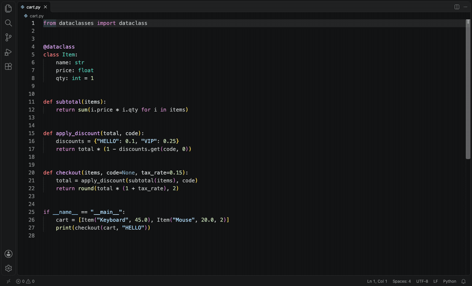

# Code Expo

Present code step by step in VS Code: each step highlights a region of code and shows its explanation in a side panel.

## Usage

### Record steps

1. Select some code.
2. Right-click and choose **Add Step from Selection**, then type the explanation.
3. Repeat. Steps can be in any file in the workspace.

Steps are saved in order to `.code-expo.json` at the workspace root. Edit that file to reorder steps or write longer text (use `\n` for line breaks).

Explanations support Markdown: headings, **bold**, *italic*, `inline code`, lists, links, quotes, tables and code blocks. Each line break is kept as written.

### Present

Run **Code Expo: Start Presentation** from the Command Palette.

| Key | Action |
|-----|--------|
| Enter, →, PageDown | Next step |
| ←, PageUp | Previous step |
| Esc | Stop |

Presentation clickers send PageUp/PageDown, so they work too.

While presenting, long lines wrap instead of showing a horizontal scrollbar. To change the font size of the code, click the **Aa** button in the editor title bar. The size is remembered for later presentations. The stop button next to it ends the presentation.

Presenting temporarily changes some editor settings (font size, word wrap, highlights, scrolling). Your own values come back when you stop, or the next time VS Code starts if it was closed mid-presentation. If they ever get stuck, run **Code Expo: Reset Editor Settings** to put those settings back to VS Code's defaults.

## Limitations

- Steps store line and column numbers, so editing the code after recording shifts the highlights.
- Only the first folder of a multi-folder workspace is used.
- The enlarged code keeps the editor's normal line height, so tall multi-line steps can overlap slightly. Lower the last value in `POP_FRAMES` (top of `extension.js`) if it bothers you.
